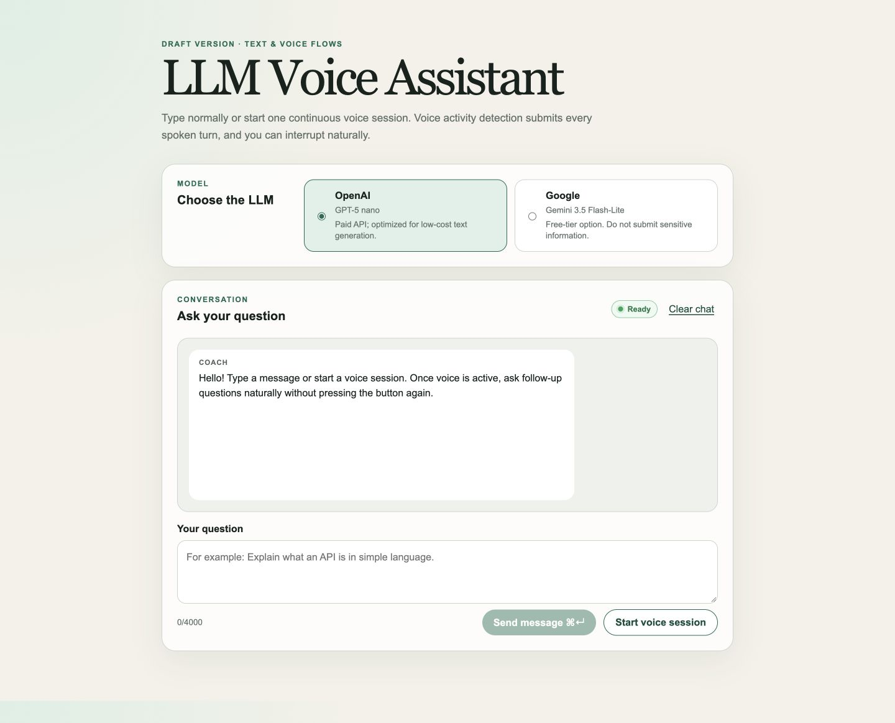

# Voice Learning Coach

A learning-focused, full-stack voice assistant that combines a selectable large
language model with ElevenLabs speech recognition and speech synthesis.

Fork this project to study or customize the complete path from microphone audio
to a streamed LLM answer and spoken response—without using a prebuilt agent
platform. The orchestration is implemented in the application so each boundary
between the browser, ASR, LLM, and TTS remains visible and understandable.



> This repository is an educational demo, not a production-ready public chat
> service. Provider usage can incur cost, and a public deployment needs user
> authentication and stronger distributed rate limiting.

## What you can build with this project

After forking the repository and supplying your own provider keys, you can:

- run a text chat using either OpenAI or Google Gemini;
- stream LLM output into the conversation as it is generated;
- start one persistent microphone session and ask multiple voice questions;
- display partial and committed ElevenLabs ASR transcripts;
- use voice activity detection (VAD) to submit a question after silence;
- convert completed answer sentences into ElevenLabs TTS audio;
- interrupt an answer by speaking and immediately ask a follow-up question;
- keep the visible conversation as context for later LLM requests;
- switch the demo off centrally to stop routes that consume provider credits;
- run locally with `.env` keys or deploy to AWS with Secrets Manager.

The project is intentionally optimized for learning. Related microphone, ASR,
LLM, TTS, barge-in, and UI code is kept in clearly marked sections instead of
being distributed across many abstractions.

## How it works

### Typed conversation

```text
Browser question
    ↓ HTTPS POST
Next.js /api/chat
    ↓ provider SDK
OpenAI Responses API or Gemini API
    ↓ normalized Server-Sent Events
Browser conversation
    ↓ completed sentence chunks
ElevenLabs TTS WebSocket
    ↓
Spoken answer
```

### Voice conversation

```text
Microphone
    ↓ live audio
ElevenLabs Realtime Scribe WebSocket
    ├── partial transcript → displayed immediately
    └── VAD commit → submitted as the user's question
                         ↓
                  selected LLM streams an answer
                         ↓
                  text appears in the conversation
                         ↓
                  ElevenLabs TTS speaks the answer
```

The ASR WebSocket remains active until the user ends the voice session. It does
not reconnect after every question. TTS uses a separate WebSocket for the
current answer.

When the user speaks while an answer is active, the application aborts the LLM
request, closes the current TTS context, stops browser audio that is already
queued, and waits for VAD to commit the replacement question. This is the
project's **barge-in** behavior.

## Main capabilities

| Capability | Implementation |
| --- | --- |
| Selectable LLM | OpenAI Responses API or Google Gemini streaming API |
| Streaming text | Provider events normalized into Server-Sent Events |
| Speech recognition | ElevenLabs Realtime Scribe over WebSocket |
| Turn detection | ElevenLabs VAD with a one-second silence threshold |
| Speech generation | ElevenLabs multi-context streaming TTS WebSocket |
| Follow-up questions | One persistent ASR/microphone session |
| Interruption | Abort LLM, cancel TTS context, and stop queued browser audio |
| Conversation context | Browser resends eligible conversation messages |
| Local secrets | Server-only values loaded from `.env` |
| AWS secrets | AWS Secrets Manager with warm-Lambda caching |
| Cost safety | Central kill switch, request-size limits, and Lambda concurrency cap |

## Technology stack

- Next.js 16 and React 19
- TypeScript
- OpenAI Node SDK
- Google Gen AI SDK
- ElevenLabs JavaScript and React SDKs
- AWS SAM and CloudFormation
- AWS Lambda Web Adapter
- Lambda Function URL with response streaming
- Amazon CloudFront with Origin Access Control
- AWS Secrets Manager

The default model and voice selections are configurable. The current example
configuration uses:

```text
OpenAI:     gpt-5-nano
Gemini:     gemini-3.5-flash-lite
ElevenLabs: eleven_flash_v2_5
Voice ID:   OYTbf65OHHFELVut7v2H
```

Model availability, pricing, quotas, and free-tier eligibility are controlled
by each provider and can change. Replace these values with models available to
your own account.

## Security boundary

Permanent provider keys never enter the browser bundle.

- OpenAI and Gemini calls are made by the Next.js server.
- The server exchanges the permanent ElevenLabs key for short-lived,
  single-use ASR and TTS browser tokens.
- The browser uses those temporary tokens to connect directly to ElevenLabs.
- Local development reads server-only keys from `.env`.
- AWS production reads the same keys from one Secrets Manager JSON secret.
- `DEMO_ENABLED=false` disables routes that can consume provider credits.

CloudFront OAC protects the Lambda origin; it does **not** authenticate people
visiting the CloudFront URL. Add application authentication, distributed rate
limiting, monitoring, and abuse controls before exposing the demo broadly.

Do not submit confidential, customer, regulated, or other sensitive data until
you have reviewed the current data-use and retention terms for every selected
provider.

## Prerequisites

- Node.js 24.6 or newer
- npm
- an OpenAI API key, a Gemini API key, or both;
- an ElevenLabs API key for voice features;
- a browser with microphone permission for voice testing.

Typed chat needs only the key for the selected LLM. Voice mode additionally
requires ElevenLabs.

## Quick start

### 1. Fork or clone the repository

Fork the project in GitHub, or clone it directly:

```bash
git clone https://github.com/dbokatov/voice-llm-assistant.git
cd voice-llm-assistant
npm ci
```

### 2. Create provider keys

#### OpenAI

1. Sign in to the [OpenAI API platform](https://platform.openai.com/).
2. Open [API keys](https://platform.openai.com/api-keys).
3. Select or create a project and create a standard project API key.
4. Confirm that the project can access the model configured in `.env`.
5. Configure billing or usage limits appropriate for your account.

A ChatGPT subscription does not provide OpenAI API credits. The application
uses the Responses API. See the
[OpenAI API quickstart](https://developers.openai.com/api/docs/quickstart).

#### Google Gemini

1. Sign in to [Google AI Studio](https://aistudio.google.com/).
2. Open the [API keys page](https://aistudio.google.com/app/apikey).
3. Create a key in a new or existing Google Cloud project.
4. Review the current quota, billing, and data-use rules for that project.

See the [Gemini API setup guide](https://ai.google.dev/gemini-api/docs/get-started).

#### ElevenLabs

1. Sign in to [ElevenLabs](https://elevenlabs.io/).
2. Open **Developers → API Keys**.
3. Create a restricted key for this project.
4. Allow the Speech to Text and Text to Speech capabilities used by the demo.
5. Apply an account-appropriate credit limit or expiry when available.

See the [ElevenLabs API-key guide](https://elevenlabs.io/docs/overview/administration/workspaces/api-keys)
and [single-use token API](https://elevenlabs.io/docs/api-reference/tokens/create).

### 3. Configure local environment values

Copy the safe example:

```bash
cp .env.example .env
```

Update `.env`:

```dotenv
# Central switch for routes that can consume provider credits.
DEMO_ENABLED=true

# Configure one or both LLM providers.
OPENAI_API_KEY=replace-with-your-openai-api-key
OPENAI_MODEL=gpt-5-nano

GEMINI_API_KEY=replace-with-your-gemini-api-key
GEMINI_MODEL=gemini-3.5-flash-lite

# Required for microphone ASR and spoken TTS answers.
ELEVENLABS_API_KEY=replace-with-your-elevenlabs-api-key
ELEVENLABS_VOICE_ID=OYTbf65OHHFELVut7v2H
ELEVENLABS_TTS_MODEL=eleven_flash_v2_5
```

Do not add `NEXT_PUBLIC_` to any API-key variable. Next.js can expose variables
with that prefix to browser JavaScript.

| Variable | Required | Purpose |
| --- | --- | --- |
| `DEMO_ENABLED` | Yes | Enables or disables provider-consuming routes |
| `OPENAI_API_KEY` | For OpenAI | Server-side OpenAI authentication |
| `OPENAI_MODEL` | No | Overrides the default OpenAI model |
| `GEMINI_API_KEY` | For Gemini | Server-side Gemini authentication |
| `GEMINI_MODEL` | No | Overrides the default Gemini model |
| `ELEVENLABS_API_KEY` | For voice | Creates temporary ASR and TTS tokens |
| `ELEVENLABS_VOICE_ID` | No | Selects the voice for spoken answers |
| `ELEVENLABS_TTS_MODEL` | No | Selects the ElevenLabs TTS model |
| `PROVIDER_SECRET_ARN` | AWS only | Selects Secrets Manager as the production key source |

Leave `PROVIDER_SECRET_ARN` unset locally. The server will then read provider
keys from `.env`.

### 4. Run locally

```bash
npm run dev
```

Open [http://localhost:3000](http://localhost:3000). Restart the development
server after changing `.env`.

If your organization requires Node to use the operating system certificate
store for outbound TLS, run `npm run dev:system-ca` instead.

### 5. Try the complete flow

1. Select an LLM with a configured API key.
2. Send a typed message and confirm that text streams into the conversation.
3. Select **Start voice session** and allow microphone access.
4. Speak and pause; VAD should commit and submit the transcript.
5. Ask a follow-up without selecting the microphone button again.
6. Speak while the coach is answering; the old answer should stop.
7. Select **End voice session** when finished.

## Project structure

```text
app/
├── page.tsx                              # UI, microphone, ASR, TTS, barge-in
└── api/
    ├── chat/route.ts                    # OpenAI/Gemini streaming orchestration
    ├── demo-status/route.ts             # Public state of the demo kill switch
    ├── elevenlabs/
    │   ├── scribe-token/route.ts        # Temporary ASR token
    │   └── tts-token/route.ts           # Temporary TTS token
    ├── health/route.ts                  # Runtime readiness endpoint
    └── _shared/
        ├── demo-access.ts               # Server-side demo kill switch
        └── provider-secrets.ts           # .env/Secrets Manager key resolver

Dockerfile                               # Multi-stage Lambda container image
template.yaml                            # SAM/CloudFormation infrastructure
.env.example                             # Safe local configuration template
```

## Conversation context and token use

Conversation history is held in browser memory and cleared by a page reload.
For each new turn, eligible earlier messages are sent again to the selected
LLM. This gives the model conversational context, but it also increases input
token usage as the conversation grows.

The server currently limits requests to:

- 64 KiB per JSON request;
- 24 conversation messages;
- 4,000 characters per message;
- 24,000 total message characters.

These limits protect the demo server, but they do not replace provider-side
budgets, quotas, authentication, or distributed rate limiting.

## TTS streaming and barge-in

The browser sends completed text segments to the ElevenLabs multi-context TTS
WebSocket while the LLM is still generating the rest of the answer.

To interrupt the current generation, the browser sends:

```json
{
  "context_id": "the-active-context-id",
  "close_context": true
}
```

It also closes the response socket and stops decoded or scheduled audio because
closing a server-side context cannot retract audio already received by the
browser.

## Validate the project

```bash
npm run check
```

This runs ESLint, TypeScript checking, and a production Next.js build. It does
not make provider API calls.

Live text and voice tests use your provider accounts and may consume credits.

## AWS deployment design

The repository includes a `Dockerfile` and `template.yaml` for this serverless
deployment boundary:

```text
Browser
    ↓ HTTPS
Amazon CloudFront
    ↓ signed origin request
Private Lambda Function URL
    ↓
Next.js container on AWS Lambda
    ├── AWS Secrets Manager
    ├── OpenAI or Gemini
    └── temporary ElevenLabs token endpoints

Browser ───────────────────────────────→ ElevenLabs ASR/TTS WebSockets
                  temporary tokens
```

The SAM template defines:

- a container-image Lambda function;
- response-streaming Function URL behavior;
- CloudFront Origin Access Control;
- CloudWatch Logs retention;
- reserved Lambda concurrency of two;
- Secrets Manager read permission limited to the configured secret;
- `DEMO_ENABLED=false` as the safe deployment default.

In AWS, the configured secret must contain:

```json
{
  "OPENAI_API_KEY": "your-openai-key",
  "GEMINI_API_KEY": "your-gemini-key",
  "ELEVENLABS_API_KEY": "your-elevenlabs-key"
}
```

When `PROVIDER_SECRET_ARN` is present, Secrets Manager becomes authoritative;
the application does not fall back to environment API keys. The parsed secret
is cached for the lifetime of the warm Lambda environment.

CloudFront OAC also requires a SHA-256 payload header for POST requests. The
browser helper adds `x-amz-content-sha256` to the chat and ElevenLabs token
requests, including empty-body requests.

The infrastructure is defined but has not been verified as a live public AWS
deployment from this repository. A Docker-enabled CI runner, AWS CodeBuild, or
another compatible build environment is required to build and publish the
Lambda image; Docker is not required merely to run the app locally.

## Customization ideas

- replace the learning-coach system instructions with another use case;
- add another LLM provider behind the normalized streaming event format;
- select a different ElevenLabs voice or supported TTS model;
- summarize older conversation turns to control token growth;
- add RAG before the LLM request;
- expose selected MCP tools through the server-side orchestrator;
- persist conversations in a database;
- add authentication, per-user quotas, and distributed rate limiting;
- add observability for latency, token usage, and provider errors.

## Known limitations

- Conversation state is browser-local and is lost on refresh.
- The application resends conversation history rather than storing an
  OpenAI/Gemini server-side conversation identifier.
- There is no user authentication.
- Limits are per application request, not per authenticated user.
- CloudFront protects the Lambda origin but does not make the website private.
- Provider behavior, available models, quotas, and pricing may change.
- The AWS workflow and live deployment still need end-to-end verification.

## License

No open-source license has been selected yet. Add a license before inviting
others to copy, modify, and redistribute the project beyond GitHub's default
repository permissions.
